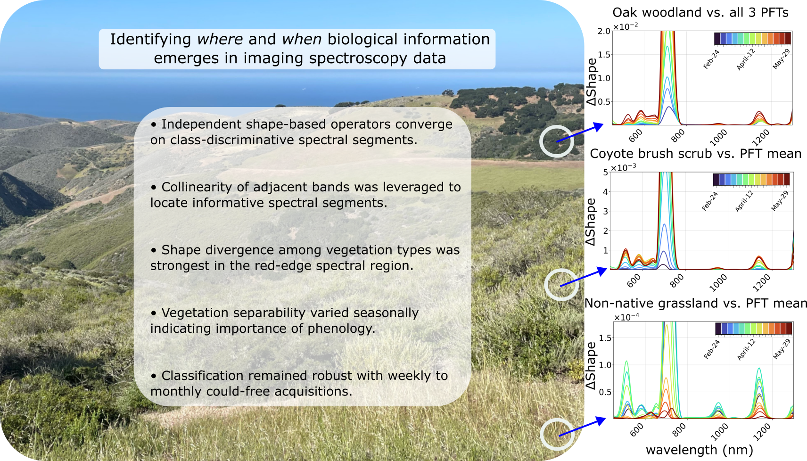

## Project overview

This is the repository containing the code and documentation supporting the study *"Spectral-temporal patterns of vegetation communities: identifying where and when
biological information emerges in imaging spectroscopy data"* (Revenga et al., 2026, Remote Sensing of Environment). 

Reproducible code, required input data and exemplary output Figures are provided in /scripts/plotting_code/.

Large raster data files (e.g. HDF5 and .parquet files) will be hosted separately (Zenodo) and linked here.

Graphical Abstract. *Photo credit: Fabian D. Schneider.*
