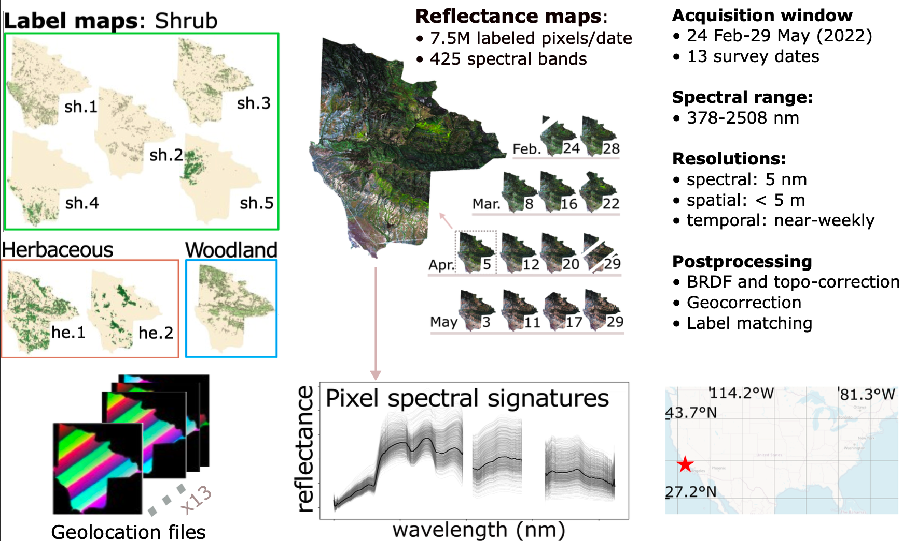
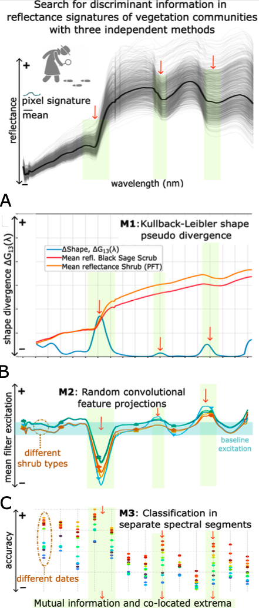

## Project overview

This is the repository containing the code and documentation supporting the study *"Spectral-temporal patterns of vegetation communities: identifying where and when
biological information emerges in imaging spectroscopy data"* (Revenga et al., 2026, Remote Sensing of Environment). 


* Reproducible code developed in support of the analyses of the study are provided in ```/scripts/*_analysis/```.

* The meteorological context, specific to the area of interest (Dangermond Preserve, Santa Barbara, CA, USA), was derived from Daymet Version 4. It is provided in ```/scripts/meteorological_context_Daymet/```.
 
* Plotting code, required input data and exemplary output Figures are provided in ```/scripts/plotting_code/```.

* Input data required has been updated to the Zenodo repository for single file size exceeding 25 MiB.

* Large raster data files (e.g. HDF5 and .parquet files) will be hosted separately in a data repository (Zenodo) and linked here.

* Both the Zenodo ```data repository``` and this GitHub ```code repository``` are public and DOI-compliant.

* ```/RGB_maps_quicklooks/``` provides RGB images derived from the mosaicked hyperspectral images (HSI), after BRDF and topographic correction, spectral rectification, intersected with the polygon of the Dangermond Preserve, for the 13 data acquisition dates (24 Feb 2022 -- 29 May 2022) of the [SHIFT imaging spectroscopy mission](https://impact.earthdata.nasa.gov/casei/campaign/SHIFT/).


Graphical Abstract. *Photo credit: Fabian D. Schneider.*  
  
 




[SHIFT mission](https://impact.earthdata.nasa.gov/casei/campaign/SHIFT/):  **overview** of the first imaging spectroscopy suborbital mission designed to capture the phenology of a changing landscape.  
  
  




Sketch of the methodology followed in this study.  
